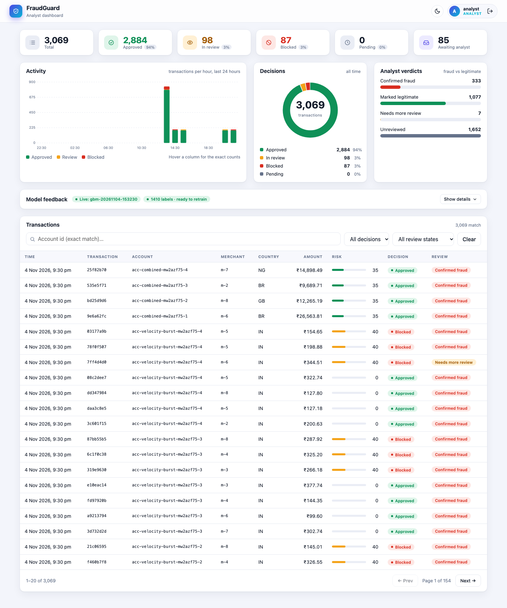
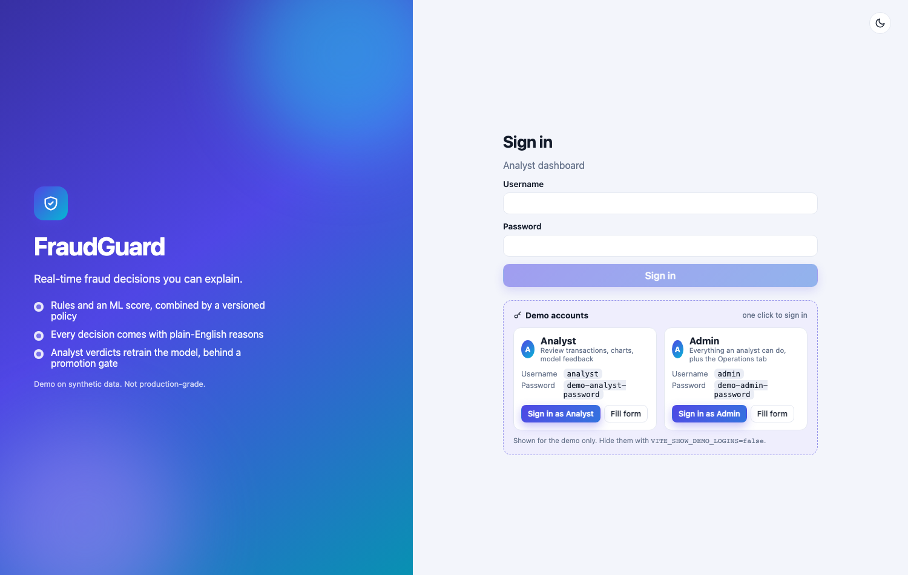
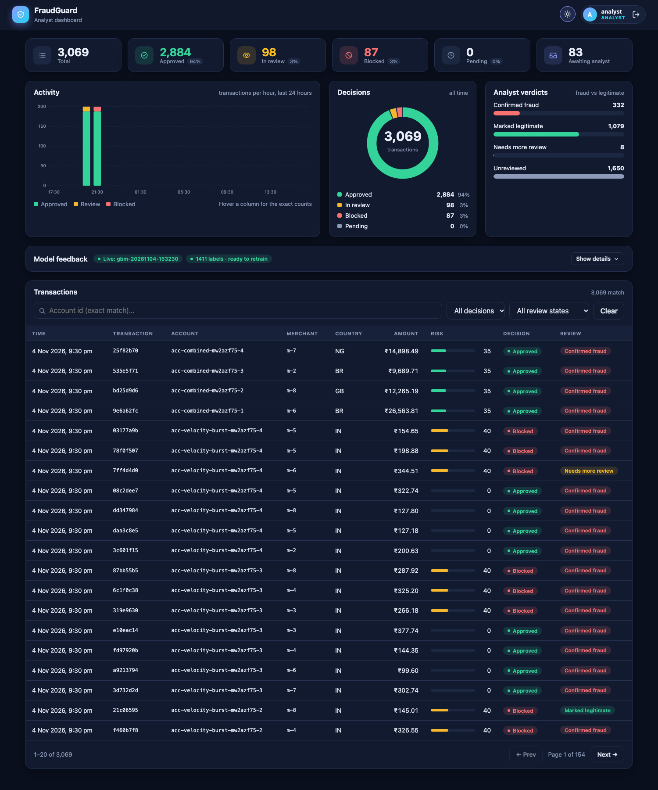
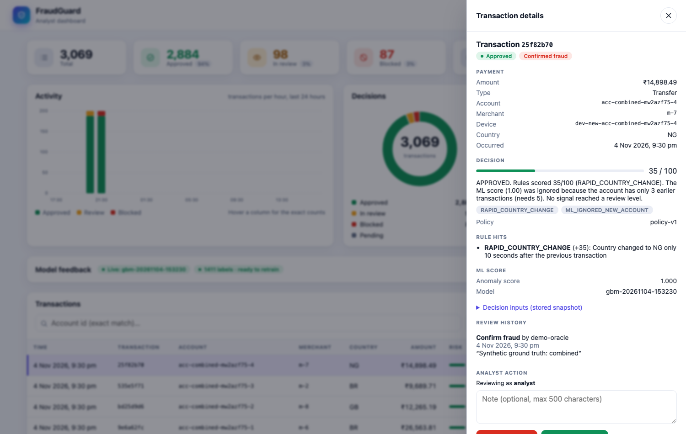
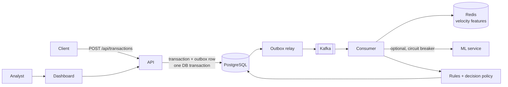
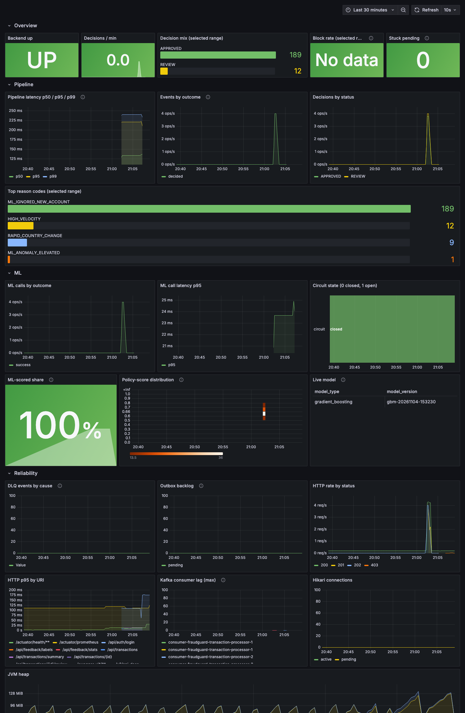

# FraudGuard: real-time fraud detection platform

[](https://github.com/OWNER/fraud-detection-platform/actions/workflows/ci.yml)
[](https://github.com/OWNER/fraud-detection-platform/actions/workflows/security.yml)
<!-- Replace OWNER with the GitHub user or organisation after publishing (docs/release-checklist.md). -->

An event-driven system that accepts payments, decides in the background whether each is `APPROVED`, `REVIEW` or `BLOCKED`
using fraud rules and an ML anomaly score, explains every decision in plain English, lets analysts review the risky ones, and
feeds their verdicts back into retraining the model.

> **Limitations and honesty.** This is a learning and portfolio project that runs on **synthetic data**. Every number in it
> (scores, block rates, model improvements) describes the demo, not real-world fraud detection accuracy. It is **not
> production-grade**: one Kafka broker, one database, shared secrets, in-memory rate limiting, no alert notifications. See
> [Limitations](#limitations).



<details><summary>More screenshots: sign-in with demo accounts, dark theme, details drawer</summary>





</details>

## What it shows

- **Event-driven pipeline** with a transactional outbox: the API answers `202` immediately, nothing is lost if Kafka is down.
- **Hybrid decision policy**: rules plus an ML score, versioned, never blocking on ML alone, every decision with reason codes and a stored snapshot of its inputs.
- **Optional ML** behind a timeout and circuit breaker: if the ML service dies, decisions continue with rules only.
- **Feedback loop**: analyst labels, retraining, a promotion gate (a new model is only used if it beats the old one), hot reload, score calibration.
- **Reliability tools**: retries, a dead-letter topic, a re-drive endpoint for stuck transactions, graceful shutdown.
- **Observability**: Prometheus metrics, a Grafana dashboard as code, 12 alert rules with runbooks, and nine failure drills that were actually run.
- **Security**: login with roles, JWT, API key for ingestion, token-protected ML service, protected metrics.
- **Tests and measurements**: coverage gates, a Redis-outage recovery test, Java/Python contract tests, frontend and end-to-end tests, k6 load tests with before/after numbers.

## Tech stack

| Area | Technology |
|---|---|
| Backend | Java 21, Spring Boot 3.5, Spring Kafka, Spring Security (JWT), JPA, Flyway, Micrometer |
| ML service | Python 3.12, FastAPI, scikit-learn (Isolation Forest, gradient boosting) |
| Frontend | React, TypeScript, Vite (served by nginx) |
| Data and messaging | PostgreSQL 16, Redis 7, Kafka 3.8 (KRaft) |
| Observability | Prometheus, Grafana |
| Quality | JUnit, Testcontainers, pytest, Vitest, Playwright, k6, JaCoCo, promtool |
| Delivery | Docker, Docker Compose, GitHub Actions, CodeQL, Trivy |

## Quick start

You need Docker with Compose, and for the demo script Node 22 (the seed script) and Python 3.

```bash
cp .env.example .env     # local demo values, all passwords and keys are for this machine only
make demo                # build, start everything, send demo data, retrain and promote a model (about 3 minutes)
```

Then open:

| What | URL | Login |
|---|---|---|
| Analyst dashboard | http://localhost:8081 | click **Sign in as Analyst** or **Admin** on the login page (the demo credentials are listed there) |
| Grafana | http://localhost:3000 | `admin` and `GRAFANA_ADMIN_PASSWORD` |
| Prometheus alerts | http://localhost:9090/alerts | none |
| API docs (Swagger UI) | http://localhost:8080/swagger-ui/index.html | none |

`make help` lists the other commands (`up`, `down`, `seed`, `test`, `lint`). Stop everything with `make down`.
Without `make`: `docker compose --profile app up -d --build` starts the application,
and `docker compose -f infra/observability/docker-compose.yml up -d` starts Prometheus and Grafana.
Developing on your machine instead of in Docker is described in [docs/observability.md](docs/observability.md#starting-and-stopping-the-stack).

## How it works



1. `POST /api/transactions` stores the transaction as `PENDING` and an outbox row in one database transaction, then returns `202`.
2. The relay publishes the event to Kafka. The consumer computes recent-behaviour features in Redis, asks the ML service for an anomaly score, runs the rules, and applies the decision policy.
3. The result (status, risk score, reason codes, explanation, inputs snapshot) is saved. Failures retry three times, then go to a dead-letter topic.

More: [architecture](docs/architecture.md) (diagrams, data model, failure modes), [decision policy](docs/decision-policy.md),
[ADRs](docs/adr/README.md) (why it is built this way).

## Feedback loop

Analyst verdicts (`CONFIRM_FRAUD`, `MARK_LEGITIMATE`) become labels. `retrain.py` trains a challenger and promotes it **only if** there
are enough labels and it beats the live model by a margin on held-out data; `POST /admin/reload` switches the running service without a
restart. In the demo the labels are synthetic, so the improvement describes the data generator, not real fraud.
Details: [docs/feedback-loop.md](docs/feedback-loop.md).

## Observability



Metrics, the dashboard, the alert table with a runbook per alert, and the recorded results of the nine failure drills:
[docs/observability.md](docs/observability.md).

## Tests and performance

142 backend tests (94.6% line coverage, gated), 45 ML tests (95% of the serving code, gated), 35 frontend tests plus an end-to-end smoke
test. How to run them: [docs/testing.md](docs/testing.md).

Measured on one laptop with synthetic traffic ([docs/performance.md](docs/performance.md) has the method and caveats):

| | Result |
|---|---|
| Ingestion at 50 req/s | p95 12 ms, 0% errors |
| Time from "accepted" to "decided" at 50 req/s | p95 0.23 s (it was 12.8 s before the outbox relay was batched) |
| Dashboard list and filter queries on 100k+ rows | p95 under 65 ms |
| 30-minute soak at 10 req/s | no errors, heap flat |

These are laptop numbers with the load generator on the same machine. They are not capacity figures for production hardware.

## Project layout

```
backend/       Spring Boot service (API, pipeline, rules, decision policy, security)
ml-service/    FastAPI scoring service, training and retraining scripts
frontend/      React dashboard, seed script, tests
infra/         Prometheus, alert rules, Grafana dashboard as code
scripts/       Local setup and the failure drills
perf/          k6 load tests and the 100k-row seed
contracts/     The agreed shape of POST /score (tested on both sides)
docs/          Architecture, ADRs, policy, observability, testing, performance, demo script
```

## Limitations

- **Synthetic data and labels.** Nothing here measures real fraud. The demo's "fraud" is whatever the data generator produces.
- **Not production-grade.** Single Kafka broker, no replication, one PostgreSQL, secrets in a `.env` file, demo passwords in `.env.example`.
- **Demo logins are public on purpose.** The sign-in page lists the demo usernames and passwords for quick demos. They are compiled into the frontend, so anyone who can open the page can read them; set `SHOW_DEMO_LOGINS=false` in `.env` and rebuild the frontend to hide them.
- **Auth is basic.** JWT tokens cannot be revoked before they expire, there are no refresh tokens, the dashboard keeps its token in `sessionStorage`, and the login rate limit is in memory and per IP (behind a proxy all users share one address).
- **Alerts are only visible in the Prometheus UI.** No Alertmanager, nothing is sent to anyone, and thresholds are untuned.
- **Retraining is manual** and re-drive of stuck transactions is manual. There is no drift monitoring.
- **Performance numbers** come from one laptop run per test; see the caveats in [docs/performance.md](docs/performance.md).

## Future work

Alertmanager with Slack or email, scheduled retraining and drift monitoring, refresh tokens, paging for the label export, live
dashboard updates instead of 10-second polling, an accessibility pass, a second model trained on a public dataset (PaySim or the
ULB credit-card set) shown as an offline benchmark.

## Contributing and licence

See [CHANGELOG.md](CHANGELOG.md). Released under the [MIT licence](LICENSE).
