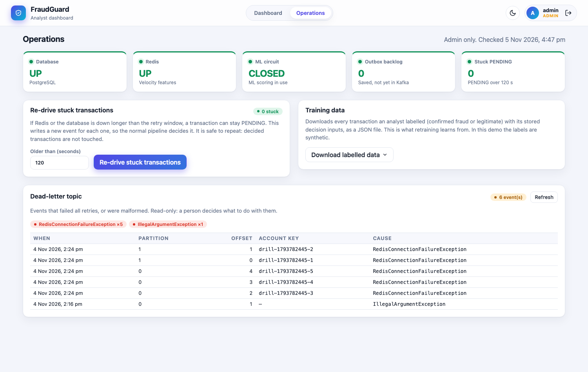
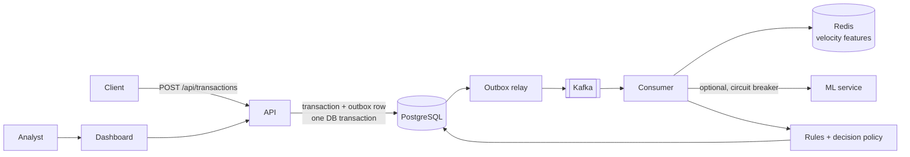

# FraudGuard: real-time fraud detection platform

[](https://github.com/nakuldagade/FraudGuard/actions/workflows/ci.yml)
[](https://github.com/nakuldagade/FraudGuard/actions/workflows/security.yml)

An event-driven system that accepts payments, decides in the background whether each is `APPROVED`, `REVIEW` or `BLOCKED`
using fraud rules and an ML anomaly score, explains every decision in plain English, lets analysts review the risky ones, and
feeds their verdicts back into retraining the model.

> **Status:** all 13 planned phases are complete (API, Kafka pipeline with outbox, Redis features, rules, ML service, decision policy,
> dashboard, feedback loop, reliability and observability, security, testing and performance, Docker and CI, documentation).


<details><summary>More screenshots: sign-in with demo accounts, dark theme, details drawer</summary>





</details>

## What it shows

- **Event-driven pipeline** with a transactional outbox: the API answers `202` immediately, nothing is lost if Kafka is down.
- **Hybrid decision policy**: rules plus an ML score, versioned, never blocking on ML alone, every decision with reason codes and a stored snapshot of its inputs.
- **Optional ML** behind a timeout and circuit breaker: if the ML service dies, decisions continue with rules only.
- **Feedback loop**: analyst labels, retraining, a promotion gate (a new model is only used if it beats the old one), hot reload, score calibration.
- **Reliability tools**: retries, a dead-letter topic, a re-drive endpoint for stuck transactions, graceful shutdown, and an admin-only **Operations** tab (live dependency status, dead-letter viewer, one-click re-drive, training-data export).
- **Observability**: Prometheus metrics, a Grafana dashboard as code, 12 alert rules with runbooks, and nine failure drills that were actually run.
- **Security**: login with roles, JWT, API key for ingestion, token-protected ML service, protected metrics.
- **Tests and measurements**: coverage gates, a Redis-outage recovery test, Java/Python contract tests, frontend and end-to-end tests, k6 load tests with before/after numbers.

## Tech stack

| Area | Technology |
|---|---|
| Backend | Java 21, Spring Boot 3.5, Spring Kafka, Spring Security (JWT), JPA, Flyway, Micrometer |
| ML service | Python 3.12, FastAPI, scikit-learn (Isolation Forest, gradient boosting) |
| Frontend | React, TypeScript, Vite (served by nginx) |
| Data and messaging | PostgreSQL 16, Redis 7, Kafka 3.8 (KRaft) |
| Observability | Prometheus, Grafana |
| Quality | JUnit, Testcontainers, pytest, Vitest, Playwright, k6, JaCoCo, promtool |
| Delivery | Docker, Docker Compose, GitHub Actions, CodeQL, Trivy |

## Quick start

You need Docker with Compose, and for the demo script Node 22 (the seed script) and Python 3.

```bash
git clone https://github.com/nakuldagade/FraudGuard.git && cd FraudGuard
cp .env.example .env     # local demo values, all passwords and keys are for this machine only
make demo                # build, start everything, send demo data, retrain and promote a model (about 3 minutes)
```

Then open:

| What | URL | Login |
|---|---|---|
| Analyst dashboard | http://localhost:8081 | click **Sign in as Analyst** or **Admin** on the login page (the demo credentials are listed there) |
| Grafana | http://localhost:3000 | `admin` and `GRAFANA_ADMIN_PASSWORD` |
| Prometheus alerts | http://localhost:9090/alerts | none |
| API docs (Swagger UI) | http://localhost:8080/swagger-ui/index.html | none |

`make help` lists the other commands (`up`, `down`, `seed`, `test`, `lint`). Stop everything with `make down`.
Without `make`: `docker compose --profile app up -d --build` starts the application,
and `docker compose -f infra/observability/docker-compose.yml up -d` starts Prometheus and Grafana.
Developing on your machine instead of in Docker is described in [docs/observability.md](docs/observability.md#starting-and-stopping-the-stack).

## Architecture

The box view of the finished system: the original box diagram from this README, redrawn with the security layer, the admin tools, the
outbox relay, the ML circuit breaker, retraining and monitoring. The flow chart under "How it works" shows the same path in a few lines.

```text
┌ Browser ───────────────────────────────────┐        ┌ Ingestion client ──────────────────────────┐
│ React dashboard, served by nginx (:8081)   │        │ A payment system or the seed script        │
│ (Vite on :5173 when developing)            │        │ POST /api/transactions                     │
│ Sign in as Analyst or Admin (JWT)          │        │ X-API-Key + Idempotency-Key headers        │
│ Charts, list, details, reviews             │        │ (a service key, not a person's login)      │
│ Admin only: the Operations tab             │        │                                            │
│ Light and dark theme                       │        │                                            │
└────────────────────────────────────────────┘        └────────────────────────────────────────────┘
                      │ /api + JWT                                           │ API key
                      ▼                                                      ▼
┌ Spring Boot backend (:8080) ─────────────────────────────────────────────────────────────────────┐
│  Security: /api = JWT login (ANALYST, ADMIN) or API key (ingestion).  /actuator = HTTP Basic.    │
│            Login limited to 5/min per IP.  Public: health, API docs.  Everything else is closed. │
│                                                                                                  │
│  ┌ REST API ───────────────────────────────────┐ ┌ Admin only (ADMIN role) ────────────────────┐ │
│  │ POST /api/transactions  ingest (202)        │ │ GET  /api/feedback/labels (training data)   │ │
│  │ GET  /api/transactions  search, filters     │ │ POST re-drive of stuck PENDING payments     │ │
│  │ GET  summary, trend, one payment            │ │ GET  dead-letter summary, system status     │ │
│  │ POST review (reviewer = logged-in user)     │ │                                             │ │
│  │ POST /api/auth/login, GET /api/auth/me      │ │ Shown in the dashboard as the               │ │
│  │ GET  /api/feedback/stats, models, registry  │ │ Operations tab                              │ │
│  └─────────────────────────────────────────────┘ └─────────────────────────────────────────────┘ │
│                                                                                                  │
│  ┌ Transaction service ─────────────────────┐      ┌ Outbox relay ────────────────────────────┐  │
│  │ Validate, check the idempotency key      │      │ Reads unsent outbox rows, 500 per batch  │  │
│  │ Save the payment as PENDING              │      │ Publishes them to transactions.raw       │  │
│  │ Write outbox row (same DB transaction)   │ ──▶  │ Marks them as published (every 200 ms)   │  │
│  │ Answer 202 Accepted                      │      │                                          │  │
│  └──────────────────────────────────────────┘      └──────────────────────────────────────────┘  │
│                                                                                                  │
│  ┌ Event consumer (3 threads, one per Kafka partition) ───────────────────────────────────────┐  │
│  │ 1  Skip an event it already applied (duplicate protection)                                 │  │
│  │ 2  Velocity features from Redis (one atomic Lua script)                                    │  │
│  │ 3  Fraud rules: rule score and reasons                                                     │  │
│  │ 4  ML score (optional): 1.5 s timeout, circuit breaker opens after 3 failures for 30 s     │  │
│  │ 5  Decision policy-v1: APPROVED / REVIEW / BLOCKED, with explanation and inputs snapshot   │  │
│  │ 6  Save to PostgreSQL. On an error: retry after 1 s, 2 s, 4 s, then transactions.dlq       │  │
│  └────────────────────────────────────────────────────────────────────────────────────────────┘  │
│                                                                                                  │
│  Also: re-drive, dead-letter and system-status tools; metrics at /actuator/prometheus            │
└──────────────────────────────────────────────────────────────────────────────────────────────────┘
            publish +                read +                   features                 POST /score
            consume                  write                    (Lua script)             + token
            │                        │                        │                        │
            ▼                        ▼                        ▼                        ▼
┌ Kafka ───────────────┐ ┌ PostgreSQL ──────────┐ ┌ Redis ───────────────┐ ┌ ML service ──────────┐
│ transactions.raw     │ │ transactions         │ │ Velocity features:   │ │ FastAPI (:8000)      │
│ transactions.dlq     │ │ outbox_events        │ │ counts 5 min / 1 h   │ │ POST /score (token)  │
│ 3 partitions each    │ │ analyst_reviews      │ │ average amount       │ │ Isolation Forest +   │
│ key = accountId      │ │ users                │ │ last device, country │ │ gradient boosting    │
│ (scored, decisions:  │ │ Flyway V1 to V9      │ │                      │ │ registry + reload    │
│  created, unused)    │ │ (port 5432)          │ │ (port 6379)          │ │ GET /metrics         │
└──────────────────────┘ └──────────────────────┘ └──────────────────────┘ └──────────────────────┘

  Around the system: retraining and monitoring
  ────────────────────────────────────────────────────────────────────────────────────────────────
┌ Retraining (offline) ┐ ┌ Prometheus (:9090) ──┐ ┌ Grafana (:3000) ─────┐ ┌ Kafka UI (:8085) ────┐
│ retrain.py           │ │ Scrapes the backend  │ │ Reads Prometheus     │ │ Reads Kafka:         │
│ labels from backend  │ │ and the ML service   │ │ FraudGuard Overview  │ │ topic browser        │
│ train a challenger   │ │ 12 alert rules       │ │ dashboard as code:   │ │ consumer groups      │
│ promotion gate       │ │ shown at /alerts     │ │ decisions, latency,  │ │ DLQ inspection       │
│ registry.json        │ │ (no Alertmanager)    │ │ ML circuit, outbox,  │ │                      │
│ POST /admin/reload   │ │                      │ │ dead letters         │ │                      │
└──────────────────────┘ └──────────────────────┘ └──────────────────────┘ └──────────────────────┘
```

Ports are the Docker Compose ones. Kafka's `transactions.scored` and `transactions.decisions` topics are created at start-up but are not used:
the consumer saves the decision straight to PostgreSQL. More detail: [docs/architecture.md](docs/architecture.md).

## How it works



1. `POST /api/transactions` stores the transaction as `PENDING` and an outbox row in one database transaction, then returns `202`.
2. The relay publishes the event to Kafka. The consumer computes recent-behaviour features in Redis, asks the ML service for an anomaly score, runs the rules, and applies the decision policy.
3. The result (status, risk score, reason codes, explanation, inputs snapshot) is saved. Failures retry three times, then go to a dead-letter topic.

More: [architecture](docs/architecture.md) (diagrams, data model, failure modes), [decision policy](docs/decision-policy.md),
[ADRs](docs/adr/README.md) (why it is built this way).

## Feedback loop

Analyst verdicts (`CONFIRM_FRAUD`, `MARK_LEGITIMATE`) become labels. `retrain.py` trains a challenger and promotes it **only if** there
are enough labels and it beats the live model by a margin on held-out data; `POST /admin/reload` switches the running service without a
restart. In the demo the labels are synthetic, so the improvement describes the data generator, not real fraud.
Details: [docs/feedback-loop.md](docs/feedback-loop.md).

## Roles

| | Analyst | Admin |
|---|---|---|
| Dashboard, charts, details, reviews, model feedback | Yes | Yes |
| **Operations** tab: system status, dead-letter viewer, re-drive, training-data export | No | Yes |

The tab is hidden for analysts, and the endpoints behind it answer `403` to them as well (tested), so hiding is only a convenience.

## Tests and performance

145 backend tests (94.6% line coverage, gated), 45 ML tests (95% of the serving code, gated), 47 frontend tests plus an end-to-end smoke
test. How to run them: [docs/testing.md](docs/testing.md).

Measured on one laptop with synthetic traffic ([docs/performance.md](docs/performance.md) has the method and caveats):

| | Result |
|---|---|
| Ingestion at 50 req/s | p95 12 ms, 0% errors |
| Time from "accepted" to "decided" at 50 req/s | p95 0.23 s (it was 12.8 s before the outbox relay was batched) |
| Dashboard list and filter queries on 100k+ rows | p95 under 65 ms |
| 30-minute soak at 10 req/s | no errors, heap flat |

These are laptop numbers with the load generator on the same machine. They are not capacity figures for production hardware.

## Project structure

Every file tracked in git, as of the completed project. Folders marked *generated* appear after you run the project but are not committed.

```text
FraudGuard/
├── .env.example                                                     # Template for local settings and demo credentials (copy to .env)
├── .gitignore                                                       # Ignores .env, build output, model files, local PDFs
├── .gitleaksignore                                                  # Three reviewed, expired test tokens the secret scanner skips
├── CHANGELOG.md                                                     # What changed in each version
├── docker-compose.yml                                               # PostgreSQL, Redis, Kafka, Kafka UI; profile 'app' adds backend, ML, frontend
├── LICENSE                                                          # MIT licence
├── Makefile                                                         # make up / down / seed / test / lint / demo / openapi
├── README.md                                                        # This file
├── .github/                                                         # GitHub automation
│   ├── dependabot.yml                                               # Weekly dependency-update PRs (Maven, pip, npm, Actions, Docker)
│   ├── pull_request_template.md                                     # Checklist shown on new pull requests
│   └── workflows/
│       ├── ci.yml                                                   # Build and test backend, ML service, frontend; config checks
│       ├── release.yml                                              # On a v* tag: push images to GHCR, create a GitHub Release
│       └── security.yml                                             # CodeQL, pip-audit, npm audit, Trivy image scans, gitleaks
│
├── backend/                                                         # Spring Boot service (package com.fraudguard, Java 21)
│   ├── .dockerignore                                                # Files kept out of the Docker build
│   ├── Dockerfile                                                   # Multi-stage, non-root image with a layered jar
│   ├── pom.xml                                                      # Maven build: dependencies, JaCoCo coverage gate
│   ├── README.md                                                    # How to run and test the backend
│   └── src/
│       ├── main/
│       │   ├── java/com/fraudguard/                                 # Application code
│       │   │   ├── FraudGuardApplication.java                       # Application entry point
│       │   │   ├── config/                                          # Configuration beans
│       │   │   │   ├── CorsConfig.java                              # Allowed browser origins and headers
│       │   │   │   ├── KafkaConfig.java                             # Topics, retry backoff, dead-letter queue, DLQ counter
│       │   │   │   ├── OpenApiConfig.java                           # API description and the two security schemes
│       │   │   │   └── RedisConfig.java                             # Redis client and template setup
│       │   │   │
│       │   │   ├── controller/                                      # REST endpoints
│       │   │   │   ├── AdminController.java                         # Admin only: re-drive, dead-letter summary, system status
│       │   │   │   ├── FeedbackController.java                      # Label export (admin) and label statistics
│       │   │   │   ├── ModelInfoController.java                     # Models in use and the live-model registry
│       │   │   │   └── TransactionController.java                   # Ingest, search, summary, trend, detail, review
│       │   │   │
│       │   │   ├── decision/                                        # Final decision policy (policy-v1)
│       │   │   │   ├── Decision.java                                # Final status plus the reasons behind it
│       │   │   │   ├── DecisionEngine.java                          # Combines rules, ML score and velocity features
│       │   │   │   ├── DecisionInputs.java                          # Snapshot of everything the policy looked at
│       │   │   │   ├── DecisionProperties.java                      # fraudguard.decision.* settings
│       │   │   │   └── MlSignal.java                                # ML score as seen by the policy
│       │   │   │
│       │   │   ├── dto/                                             # Request, response and event objects
│       │   │   │   ├── FeedbackStatsDTO.java                        # Label counts
│       │   │   │   ├── LabeledTransactionDTO.java                   # One labelled row for training
│       │   │   │   ├── MlScoreRequest.java                          # Body sent to the ML service
│       │   │   │   ├── MlScoreResponse.java                         # Answer from the ML service
│       │   │   │   ├── ModelUsageDTO.java                           # Transactions scored per model version
│       │   │   │   ├── PageResponseDTO.java                         # Paged list envelope
│       │   │   │   ├── ReviewResponseDTO.java                       # One review in the history
│       │   │   │   ├── RuleHit.java                                 # One fired rule: code, score, reason
│       │   │   │   ├── SystemStatusDTO.java                         # Operations tab status snapshot
│       │   │   │   ├── TransactionDetailDTO.java                    # Transaction, inputs snapshot, review history
│       │   │   │   ├── TransactionEvent.java                        # Kafka event payload
│       │   │   │   ├── TransactionRequestDTO.java                   # Ingestion body (validated)
│       │   │   │   ├── TransactionResponseDTO.java                  # A transaction as the API returns it
│       │   │   │   ├── TransactionSearchCriteria.java               # The dashboard's filters
│       │   │   │   ├── TransactionStatusUpdateDTO.java              # Review request body (reviewer field ignored)
│       │   │   │   ├── TransactionSummaryDTO.java                   # Dashboard header counts
│       │   │   │   ├── TrendPointDTO.java                           # One hour of the activity chart
│       │   │   │   └── VelocityFeatures.java                        # Redis-derived behaviour features
│       │   │   │
│       │   │   ├── entity/                                          # JPA entities and enums
│       │   │   │   ├── AnalystReview.java                           # One analyst action (append-only history)
│       │   │   │   ├── AppUser.java                                 # A dashboard user (BCrypt password hash)
│       │   │   │   ├── OutboxEvent.java                             # Transactional outbox row
│       │   │   │   ├── ReviewAction.java                            # CONFIRM_FRAUD, MARK_LEGITIMATE, REQUEST_FURTHER_REVIEW
│       │   │   │   ├── ReviewState.java                             # UNREVIEWED, CONFIRMED_FRAUD, MARKED_LEGITIMATE, NEEDS_MORE_REVIEW
│       │   │   │   ├── Role.java                                    # ANALYST or ADMIN
│       │   │   │   ├── RuleHitsConverter.java                       # Stores fired rules in one database column
│       │   │   │   ├── Transaction.java                             # A payment and its decision
│       │   │   │   ├── TransactionStatus.java                       # PENDING, APPROVED, REVIEW, BLOCKED
│       │   │   │   └── TransactionType.java                         # Kind of payment
│       │   │   │
│       │   │   ├── exception/                                       # Error handling
│       │   │   │   ├── GlobalExceptionHandler.java                  # Errors as JSON problem details
│       │   │   │   ├── IdempotencyConflictException.java            # Same key, different body (409)
│       │   │   │   └── ResourceNotFoundException.java               # Not found (404)
│       │   │   │
│       │   │   ├── repository/                                      # Database access (Spring Data JPA)
│       │   │   │   ├── AnalystReviewRepository.java                 # Review history queries
│       │   │   │   ├── OutboxEventRepository.java                   # Unsent outbox rows and counts
│       │   │   │   ├── TransactionRepository.java                   # Counts, hourly trend, stuck-PENDING queries
│       │   │   │   ├── TransactionSpecifications.java               # Builds the dashboard's dynamic filters
│       │   │   │   └── UserRepository.java                          # Find a user by username
│       │   │   │
│       │   │   ├── rules/                                           # Fraud rules
│       │   │   │   ├── FraudRule.java                               # Interface every rule implements
│       │   │   │   ├── HighVelocityRule.java                        # Too many transactions in 5 minutes or an hour
│       │   │   │   ├── NewDeviceHighAmountRule.java                 # New device combined with a high amount
│       │   │   │   ├── RapidCountryChangeRule.java                  # Country changed within an hour
│       │   │   │   ├── RiskAssessment.java                          # Rule score, verdict and fired rules
│       │   │   │   ├── RuleEngine.java                              # Runs all rules and adds up the score
│       │   │   │   ├── RuleProperties.java                          # fraudguard.rules.* thresholds
│       │   │   │   └── UnusualAmountRule.java                       # Amount far above the account's usual amount
│       │   │   │
│       │   │   ├── security/                                        # Login, roles, API key, rate limit
│       │   │   │   ├── ApiKeyAuthenticationFilter.java              # X-API-Key check for ingestion
│       │   │   │   ├── ApiSecurityErrorHandler.java                 # 401 and 403 as JSON
│       │   │   │   ├── AuthController.java                          # POST /api/auth/login and GET /api/auth/me
│       │   │   │   ├── JwtService.java                              # Creates and checks login tokens
│       │   │   │   ├── LoginRateLimiter.java                        # 5 login attempts per minute per IP
│       │   │   │   ├── SecurityConfig.java                          # The three filter chains and the route rules
│       │   │   │   ├── SecurityProperties.java                      # fraudguard.security.* settings
│       │   │   │   └── UserSeeder.java                              # Creates the first users from environment variables
│       │   │   │
│       │   │   └── service/                                         # Pipeline and business logic
│       │   │       ├── DlqService.java                              # Reads the dead-letter topic (read-only)
│       │   │       ├── FeedbackService.java                         # Label export and statistics
│       │   │       ├── MlServiceClient.java                         # Calls the ML service: timeout and circuit breaker
│       │   │       ├── ModelInfoService.java                        # Models in use, registry from the ML service
│       │   │       ├── OutboxMetrics.java                           # Outbox backlog gauge
│       │   │       ├── OutboxRelay.java                             # Publishes outbox rows to Kafka in batches
│       │   │       ├── RedriveService.java                          # Re-queues transactions stuck in PENDING
│       │   │       ├── StuckPendingMetrics.java                     # Stuck-PENDING gauge
│       │   │       ├── SystemStatusService.java                     # Dependency health for the Operations tab
│       │   │       ├── TransactionCacheService.java                 # Velocity features in Redis (Lua script)
│       │   │       ├── TransactionEventConsumer.java                # Kafka consumer: features, ML, rules, decision, metrics
│       │   │       ├── TransactionService.java                      # Service interface
│       │   │       └── TransactionServiceImpl.java                  # Create (with outbox), search, summary, trend, review
│       │   │
│       │   └── resources/                                           # Settings, migrations, Lua script
│       │       ├── application-docker.yml                           # Settings inside Docker Compose
│       │       ├── application.yml                                  # All settings (secrets come from environment variables)
│       │       ├── db/migration/                                    # Flyway SQL migrations
│       │       │   ├── V1__Create_transactions_table.sql            # transactions table
│       │       │   ├── V2__Add_processed_event_id.sql               # Duplicate-event protection
│       │       │   ├── V3__Create_outbox_events_table.sql           # Transactional outbox
│       │       │   ├── V4__Add_rule_assessment.sql                  # Rule score and fired rules
│       │       │   ├── V5__Add_anomaly_score_and_model_version.sql  # ML score and model version
│       │       │   ├── V6__Add_decision_details.sql                 # Policy, reason codes, explanation, inputs
│       │       │   ├── V7__Add_analyst_reviews.sql                  # Analyst review history and state
│       │       │   ├── V8__users.sql                                # users table (login)
│       │       │   └── V9__status_review_index.sql                  # Composite index for dashboard counts
│       │       │
│       │       └── redis/
│       │           └── record_transaction.lua                       # Atomic update and read of recent behaviour
│       │
│       └── test/                                                    # Tests
│           ├── java/com/fraudguard/                                 # Test code
│           │   ├── TestAuth.java                                    # Test helper: API key and analyst/admin tokens
│           │   ├── config/
│           │   │   └── TestcontainersConfig.java                    # Starts PostgreSQL, Kafka and Redis for tests
│           │   │
│           │   ├── controller/
│           │   │   ├── SystemStatusApiTest.java                     # Operations status; analyst gets 403
│           │   │   ├── TransactionControllerTest.java               # Ingest, idempotent replay, validation
│           │   │   ├── TransactionReviewApiTest.java                # List, filters, paging, reviews, CORS
│           │   │   └── TransactionTrendApiTest.java                 # Hourly activity chart data
│           │   │
│           │   ├── decision/
│           │   │   └── DecisionEngineTest.java                      # All 15 rule x ML combinations, thresholds
│           │   │
│           │   ├── rules/
│           │   │   └── RuleEngineTest.java                          # Rule scoring and verdict bands
│           │   │
│           │   ├── security/
│           │   │   ├── OpenApiTest.java                             # API description is public and complete
│           │   │   ├── SecurityApiTest.java                         # Every route x role, token tampering, expiry, login limit
│           │   │   └── SecurityUnitTest.java                        # Rate limiter and JWT secret rules
│           │   │
│           │   └── service/
│           │       ├── FeedbackServiceTest.java                     # Label rules and statistics
│           │       ├── FraudDecisionTest.java                       # End to end decisions with rules
│           │       ├── MlContractTest.java                          # Java side of the /score contract
│           │       ├── MlScoringIntegrationTest.java                # End to end with a fake ML service
│           │       ├── MlServiceClientMetricsTest.java              # Call outcomes, circuit gauge, token header
│           │       ├── MlServiceClientTest.java                     # Timeouts, errors, circuit breaker
│           │       ├── OutboxRelayTest.java                         # Batch publishing and failure handling
│           │       ├── RedisOutageIntegrationTest.java              # Redis frozen, dead-letter, re-drive recovery
│           │       ├── ReliabilityIntegrationTest.java              # Re-drive and dead-letter summary
│           │       ├── StuckPendingMetricsTest.java                 # Backlog gauges
│           │       ├── TransactionCacheServiceTest.java             # Velocity features
│           │       ├── TransactionEventConsumerMetricsTest.java     # Outcomes, counters, latency
│           │       └── TransactionEventConsumerTest.java            # Pipeline, duplicates, poison messages
│           │
│           └── resources/
│               └── application-test.yml                             # Test-only secrets and settings
│
├── contracts/                                                       # Shared contracts between services
│   └── ml-score.schema.json                                         # JSON Schema of POST /score (tested in Java and Python)
│
├── docs/                                                            # Documentation
│   ├── api-examples.http                                            # Ready-made API requests
│   ├── architecture.md                                              # Diagrams, data model, topics, failure modes
│   ├── decision-policy.md                                           # The exact decision rules
│   ├── demo-script.md                                               # A 5-minute demo walkthrough
│   ├── feedback-loop.md                                             # Labels, retraining, promotion, rollback
│   ├── observability.md                                             # Metrics, alerts, runbooks, drill results
│   ├── openapi.json                                                 # Generated API description
│   ├── performance.md                                               # Load-test method, results, caveats
│   ├── portfolio.md                                                 # Resume bullets, post draft, interview Q and A
│   ├── release-checklist.md                                         # Steps before publishing
│   ├── testing.md                                                   # How it is tested, coverage numbers
│   ├── adr/                                                         # Architecture decision records (why it is built this way)
│   │   ├── 0001-event-driven-pipeline-with-kafka.md                 # Why Kafka and an asynchronous pipeline
│   │   ├── 0002-transactional-outbox.md                             # Why the outbox, and the relay batching lesson
│   │   ├── 0003-retries-and-dlq.md                                  # Retries, dead-letter topic, the Redis timeout lesson
│   │   ├── 0004-redis-velocity-features.md                          # Why Redis for recent behaviour
│   │   ├── 0005-hybrid-rules-and-ml-policy.md                       # Why rules plus ML, and ML never blocks alone
│   │   ├── 0006-optional-ml-with-circuit-breaker.md                 # Why scoring is optional
│   │   ├── 0007-feedback-loop-promotion-gate-calibration.md         # Safe retraining and promotion
│   │   ├── 0008-stateless-jwt.md                                    # Login design and its limits
│   │   ├── 0009-prometheus-and-grafana.md                           # Why these monitoring tools
│   │   └── README.md                                                # Index of the decision records
│   │
│   └── images/                                                      # Screenshots used in the README and docs
│       ├── api-docs.png                                             # Swagger UI
│       ├── dashboard-dark.png                                       # Dashboard, dark theme
│       ├── dashboard.png                                            # Dashboard, light theme
│       ├── drawer.png                                               # Transaction details drawer
│       ├── grafana.png                                              # Grafana dashboard
│       ├── login.png                                                # Sign-in page with demo accounts
│       └── operations.png                                           # Admin-only Operations tab
│
├── frontend/                                                        # React + TypeScript + Vite dashboard
│   ├── .dockerignore                                                # Files kept out of the Docker build
│   ├── .gitignore                                                   # Frontend-specific ignores
│   ├── Dockerfile                                                   # Build, then nginx (non-root)
│   ├── eslint.config.js                                             # Lint rules
│   ├── index.html                                                   # Page shell; applies the saved theme before first paint
│   ├── nginx.conf                                                   # Serves the app, proxies /api to the backend
│   ├── package-lock.json                                            # Exact dependency versions
│   ├── package.json                                                 # Scripts and dependencies
│   ├── playwright.config.ts                                         # Playwright setup
│   ├── README.md                                                    # How to run and test the frontend
│   ├── tsconfig.app.json                                            # TypeScript settings (app)
│   ├── tsconfig.json                                                # TypeScript project references
│   ├── tsconfig.node.json                                           # TypeScript settings (build tooling)
│   ├── vite.config.ts                                               # Vite and Vitest settings
│   ├── e2e/                                                         # Playwright browser tests (real stack)
│   │   └── smoke.e2e.ts                                             # Analyst review flow; admin Operations tab
│   │
│   ├── public/                                                      # Static files
│   │   ├── favicon.svg                                              # Browser tab icon
│   │   └── icons.svg                                                # Static icon file
│   │
│   ├── scripts/                                                     # Command-line helpers
│   │   ├── seed-demo.mjs                                            # Sends demo transactions (npm run seed)
│   │   └── take-screenshots.mjs                                     # Takes the README screenshots
│   │
│   └── src/                                                         # Dashboard source
│       ├── App.tsx                                                  # Layout, tabs, details drawer, toast
│       ├── feedbackTypes.ts                                         # Shapes of the feedback endpoints
│       ├── index.css                                                # Styles: light and dark themes, animations
│       ├── main.tsx                                                 # App entry: providers and login gate
│       ├── types.ts                                                 # Shapes of the backend's JSON
│       ├── auth/                                                    # Login state
│       │   ├── authContext.ts                                       # Login context definition
│       │   ├── AuthGate.tsx                                         # Shows the login page until signed in
│       │   ├── AuthProvider.tsx                                     # Login, logout, 401 handling
│       │   ├── demo.ts                                              # One-click demo accounts (demo only)
│       │   ├── session.ts                                           # Token kept in sessionStorage
│       │   └── useAuth.ts                                           # Hook to read the login state
│       │
│       ├── components/                                              # UI components
│       │   ├── DecisionInputs.tsx                                   # Shows the stored inputs snapshot
│       │   ├── DetailPanel.tsx                                      # Transaction details (inside the drawer)
│       │   ├── Drawer.tsx                                           # Slide-in panel (Esc closes)
│       │   ├── FeedbackPanel.tsx                                    # Model feedback card
│       │   ├── Filters.tsx                                          # Search and filter bar
│       │   ├── Icons.tsx                                            # Inline SVG icons
│       │   ├── Insights.tsx                                         # The three chart cards
│       │   ├── LoginPage.tsx                                        # Sign-in page with demo accounts
│       │   ├── OperationsView.tsx                                   # Admin tab: status, re-drive, dead letters, export
│       │   ├── Pagination.tsx                                       # Page controls
│       │   ├── ReviewActions.tsx                                    # Review buttons and note box
│       │   ├── StatusBadge.tsx                                      # Decision and review pills
│       │   ├── SummaryHeader.tsx                                    # Top bar, tabs, KPI cards
│       │   ├── ThemeToggle.tsx                                      # Sun/moon button
│       │   ├── Toast.tsx                                            # Short confirmation message
│       │   ├── TransactionTable.tsx                                 # The transaction list
│       │   └── charts/                                              # Hand-built SVG charts
│       │       ├── BarList.tsx                                      # Horizontal bars
│       │       ├── DonutChart.tsx                                   # Ring chart
│       │       └── TrendChart.tsx                                   # Activity columns per hour
│       │
│       ├── hooks/                                                   # Data loading
│       │   ├── useCountUp.ts                                        # Animated counting numbers
│       │   ├── useFeedback.ts                                       # Loads the feedback endpoints
│       │   ├── useSummary.ts                                        # Loads the header counts
│       │   ├── useTransactionDetail.ts                              # Loads one transaction
│       │   ├── useTransactions.ts                                   # Loads the transaction list
│       │   └── useTrend.ts                                          # Loads the activity chart data
│       │
│       ├── lib/                                                     # API calls and formatting
│       │   ├── api.ts                                               # All backend calls (adds the bearer token)
│       │   ├── feedbackApi.ts                                       # Feedback endpoint calls
│       │   └── format.ts                                            # Money, date and risk helpers
│       │
│       ├── test/                                                    # Vitest tests with a fake API (MSW)
│       │   ├── auth.test.tsx                                        # Login, session, 401, logout
│       │   ├── dashboard.test.tsx                                   # List, filters, paging, details, review, model feedback
│       │   ├── helpers.tsx                                          # Renders the app signed in
│       │   ├── operations.test.tsx                                  # Operations tab and who sees it
│       │   ├── server.ts                                            # Fake API (MSW)
│       │   ├── setup.ts                                             # Test setup
│       │   └── ui.test.tsx                                          # Demo accounts, theme, drawer, charts
│       │
│       └── theme/
│           └── theme.ts                                             # Light/dark switch
│
├── infra/                                                           # Infrastructure as code
│   ├── .gitkeep                                                     # Keeps the folder in git
│   └── observability/                                               # Prometheus and Grafana
│       ├── alerts.yml                                               # 12 alert rules
│       ├── alerts_test.yml                                          # Unit tests for the alert rules (promtool)
│       ├── docker-compose.yml                                       # Starts Prometheus and Grafana
│       ├── prometheus.yml                                           # Scrape config: backend and ML service
│       └── grafana/                                                 # Grafana provisioning
│           ├── dashboards/
│           │   └── fraudguard-overview.json                         # The dashboard, stored as code
│           │
│           └── provisioning/
│               ├── dashboards/
│               │   └── dashboards.yml                               # Loads dashboards from files
│               │
│               └── datasources/
│                   └── prometheus.yml                               # Prometheus data source
│
├── ml-service/                                                      # FastAPI scoring service (Python)
│   ├── .dockerignore                                                # Files kept out of the Docker build
│   ├── Dockerfile                                                   # Trains isoforest-v1 at build time; non-root
│   ├── pytest.ini                                                   # Test settings, 85% coverage gate
│   ├── requirements.txt                                             # Pinned dependencies
│   ├── app/                                                         # The service
│   │   ├── __init__.py                                              # Makes app a package
│   │   ├── features.py                                              # Feature layout (shared with training)
│   │   ├── main.py                                                  # Routes: /score, /health, /metrics, /admin/*
│   │   ├── metrics.py                                               # Prometheus metrics
│   │   ├── model.py                                                 # Loads a model, scores, calibrates
│   │   ├── registry.py                                              # Which model version is live
│   │   ├── schemas.py                                               # Request and response shapes
│   │   └── security.py                                              # Service and admin token checks
│   │
│   ├── data/                                                        # Exported labels and raw data (generated, git-ignored)
│   ├── models/                                                      # Trained models and registry.json (generated, git-ignored)
│   ├── tests/                                                       # pytest tests
│   │   ├── conftest.py                                              # Test tokens and a pinned model
│   │   ├── test_api.py                                              # Score and health API
│   │   ├── test_contract.py                                         # Python side of the /score contract
│   │   ├── test_features.py                                         # Feature extraction
│   │   ├── test_feedback_loop.py                                    # Retrain, gate, promote, reload
│   │   ├── test_security_and_metrics.py                             # Tokens, open routes, metrics, failed reload
│   │   └── test_training.py                                         # Synthetic data and the baseline model
│   │
│   └── training/                                                    # Training and retraining
│       ├── build_dataset.py                                         # Turns exported labels into training rows
│       ├── retrain.py                                               # Retrain, promotion gate, promote
│       └── train.py                                                 # Synthetic data and the baseline model
│
├── perf/                                                            # Load tests (k6) and the 100k-row seed
│   ├── cleanup.sql                                                  # Removes the synthetic and load-test rows
│   ├── ingest.js                                                    # Ingestion load test (also the end-to-end test)
│   ├── read.js                                                      # List and filter queries on a big table
│   ├── run.sh                                                       # Runs a k6 test from Docker and reads Prometheus
│   ├── seed-100k.sql                                                # Adds 100,000 synthetic rows for read tests
│   ├── soak.js                                                      # 30-minute steady load
│   ├── summarize.py                                                 # Prints the key numbers of a k6 summary
│   └── results/                                                     # Saved k6 summaries
│       ├── e2e-1793785300.json                                      # End-to-end run before tuning
│       ├── e2e-1793785932.json                                      # End-to-end run after tuning
│       └── soak-1793786302.json                                     # 30-minute soak run
│
└── scripts/                                                         # Local setup and failure drills
    ├── release-notes.sh                                             # Takes a version's notes from CHANGELOG.md
    ├── setup-local-env.sh                                           # Creates .env and the Prometheus password file
    └── drills/                                                      # One script per failure drill (waits for Enter)
        ├── 01-ml-service-down.sh                                    # Drill 1: ML service down
        ├── 02-ml-service-hangs.sh                                   # Drill 2: ML service frozen
        ├── 03-redis-down.sh                                         # Drill 3: Redis down, then re-drive
        ├── 04-kafka-down.sh                                         # Drill 4: Kafka down, outbox drains
        ├── 05-postgres-down.sh                                      # Drill 5: PostgreSQL down
        ├── 06-poison-message.sh                                     # Drill 6: malformed message to the DLQ
        ├── 07-duplicate-event.sh                                    # Drill 7: duplicate event skipped
        ├── 08-backend-restart-under-load.sh                         # Drill 8: restart while seeding
        ├── 09-corrupt-registry.sh                                   # Drill 9: corrupt model registry
        └── _lib.sh                                                  # Shared helpers for the drills
```

## Limitations

- **Synthetic data and labels.** Nothing here measures real fraud. The demo's "fraud" is whatever the data generator produces.
- **Not production-grade.** Single Kafka broker, no replication, one PostgreSQL, secrets in a `.env` file, demo passwords in `.env.example`.
- **Demo logins are public on purpose.** The sign-in page lists the demo usernames and passwords for quick demos. They are compiled into the frontend, so anyone who can open the page can read them; set `SHOW_DEMO_LOGINS=false` in `.env` and rebuild the frontend to hide them.
- **Auth is basic.** JWT tokens cannot be revoked before they expire, there are no refresh tokens, the dashboard keeps its token in `sessionStorage`, and the login rate limit is in memory and per IP (behind a proxy all users share one address).
- **Alerts are only visible in the Prometheus UI.** No Alertmanager, nothing is sent to anyone, and thresholds are untuned.
- **Retraining is manual** and re-drive of stuck transactions is manual. There is no drift monitoring.
- **Performance numbers** come from one laptop run per test; see the caveats in [docs/performance.md](docs/performance.md).


## Author, contributing and licence

Built by **Nakul Dagade** as a learning and portfolio project. See [CHANGELOG.md](CHANGELOG.md) for what changed, and
[docs/release-checklist.md](docs/release-checklist.md) for publishing notes. Released under the [MIT licence](LICENSE).
