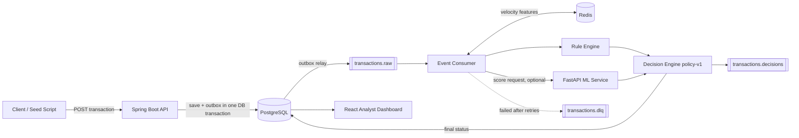

# FraudGuard: Real-Time Fraud Detection Platform

An event-driven fintech platform that scores card transactions in real time using a rule engine, per-account behavioural features in Redis, and an ML anomaly model. Every transaction ends up **APPROVED**, **REVIEW**, or **BLOCKED**, with the reasons recorded, and analysts act on flagged ones in a React dashboard.

> **Note:** This is a portfolio project. It runs on synthetic data and is not production-grade. Phases 1-8 of the roadmap are complete; Phase 9 (feedback and retraining) is in progress.

---

## Overview

FraudGuard accepts transactions through a REST API, moves them through a Kafka pipeline, enriches them with Redis-backed behavioural features, and produces an explainable risk decision. The decision policy is versioned (`policy-v1`) and every stored decision records which policy made it.

Design goals:

- **Event-driven architecture** with reliable messaging: transactional outbox, retries with backoff, dead-letter queue.
- **Rules + ML in one transparent policy**: thresholds live in configuration, not code.
- **Resilience**: if the ML service is down or slow, rules still decide and the pipeline keeps flowing.

---

## Key Features

- **Async transaction API**: `POST` returns `202 Accepted`; scoring happens off the request path.
- **Kafka pipeline** with four topics: `transactions.raw`, `transactions.scored`, `transactions.decisions`, `transactions.dlq`.
- **Transactional outbox**: the transaction and its event are committed together, so neither is lost.
- **Redis velocity features**: transaction counts over 5-minute and 1-hour windows plus per-account behaviour (usual amount, device, country).
- **Configurable rule engine** with four rules, each producing a score and a human-readable reason:
  - high velocity
  - unusual amount (z-score)
  - new device with a high amount
  - rapid country change
- **ML scoring service**: FastAPI + Isolation Forest, called through a client with a timeout and circuit breaker.
- **Decision engine (`policy-v1`)** combining rule verdict, ML score, and velocity. See [`docs/decision-policy.md`](docs/decision-policy.md).
- **Analyst dashboard** (React + TypeScript): list, filter, paging, summary stats, and review actions.
- **Dead-letter queue**, **rate limiting**, **CORS configuration**, **Redis caching**, **versioned SQL migrations**, and a **health endpoint**.

---

## Architecture



**Transaction lifecycle:** `PENDING` -> `APPROVED` | `REVIEW` | `BLOCKED`

---

## Tech Stack

### Backend (Java)

| Technology | Purpose |
|---|---|
| Java 21 | Core language |
| Spring Boot 3.5 | Application framework: REST API, dependency injection, configuration, profiles |
| Spring Web | REST controllers and JSON handling |
| Spring Validation | Request validation (`@NotBlank`, `@DecimalMin`, ...) |
| Spring Data JPA / Hibernate | Maps entities to PostgreSQL tables |
| Flyway | Versioned SQL migrations (V1-V7); Hibernate only validates the schema |
| Spring for Apache Kafka | Producer (`KafkaTemplate`), consumer (`@KafkaListener`), dead-letter handling |
| Spring Data Redis (Lettuce) | Velocity features and caching via `StringRedisTemplate` |
| Spring Boot Actuator | `/actuator/health` endpoint |
| Lombok | Removes getter/setter boilerplate at compile time |
| PostgreSQL JDBC driver | Database connectivity |
| Maven | Build and dependency management |
| JUnit, Spring Boot Test | Unit and integration tests |
| Testcontainers | Throwaway PostgreSQL and Kafka in Docker for realistic integration tests |

### ML Service (Python)

| Technology | Purpose |
|---|---|
| FastAPI | HTTP API that serves anomaly scores (includes a `/health` endpoint) |
| Uvicorn | ASGI server that runs FastAPI |
| scikit-learn (Isolation Forest) | Unsupervised anomaly detection model |
| NumPy | Numerical feature handling |
| joblib | Saving and loading the trained model artifact |
| Pydantic (bundled with FastAPI) | Request and response schemas |
| pytest + httpx | Tests for the scoring API |

Versions of NumPy and scikit-learn are pinned exactly, because a saved model must be loaded with the same versions that trained it.

### Infrastructure (Docker)

| Technology | Purpose |
|---|---|
| Docker Compose | Runs the local environment with one command |
| Apache Kafka 3.8 (KRaft mode) | Event streaming backbone; single node, no ZooKeeper |
| Kafka UI (kafbat) | Browser tool to inspect topics and messages |
| PostgreSQL 16 | System of record: transactions, outbox, analyst reviews |
| Redis 7 | Low-latency velocity counters and caching |

### Frontend

| Technology | Purpose |
|---|---|
| React 19 | Analyst dashboard UI |
| TypeScript | Type safety across components and API calls |
| Vite | Dev server and production build |
| ESLint (+ React Hooks plugin) | Code quality checks |
| `seed-demo.mjs` (Node) | Sends demo transactions so the dashboard has data |

---

## Project Structure

```text
fraudguard/
├── backend/                          # Spring Boot service (package com.fraudguard)
│   ├── pom.xml
│   └── src/main/
│       ├── java/com/fraudguard/
│       │   ├── config/               # KafkaConfig, RedisConfig, CorsConfig
│       │   ├── controller/           # REST controllers
│       │   ├── dto/                  # Request/response objects and events
│       │   ├── entity/               # Transaction, TransactionStatus, TransactionType
│       │   ├── exception/            # Global error handling
│       │   ├── filter/               # RateLimitFilter, CachedBodyHttpServletRequest
│       │   ├── repository/           # JPA repositories
│       │   ├── service/              # Transaction service, event consumer, cache, MlServiceClient
│       │   └── decision/             # Decision engine (policy-v1)
│       └── resources/
│           ├── application.yml       # Profiles: local (default), test
│           └── db/migration/         # Flyway SQL migrations
├── ml-service/                       # FastAPI ML scoring service
│   ├── app/                          # main.py, model.py, features.py, schemas.py
│   ├── models/                       # isoforest-v1.joblib
│   ├── training/                     # train.py
│   ├── tests/                        # pytest suite
│   └── requirements.txt
├── frontend/                         # React + TypeScript dashboard (Vite)
│   └── scripts/seed-demo.mjs         # Demo data generator
├── docs/                             # decision-policy.md and other docs
├── infra/                            # Infrastructure configuration
└── docker-compose.yml                # PostgreSQL, Redis, Kafka, Kafka UI, ML service
```

---

## How It Works

1. **Ingest:** a client sends a transaction to the API. It is validated, saved as `PENDING`, and an event is written to the **outbox table** in the same database transaction. The API responds `202 Accepted`.
2. **Publish:** the event is published to the `transactions.raw` topic. The producer waits for full broker acknowledgement and is idempotent, so retries never create duplicates.
3. **Consume:** the event consumer (consumer group `fraudguard-transaction-processor`) reads the event and computes **velocity features** from Redis.
4. **Rules:** the rule engine evaluates four rules and returns a risk score with reasons. A rule score of 40 or more means the rules say `REVIEW`; 80 or more means `BLOCKED`.
5. **ML scoring:** the consumer asks the ML service for an anomaly score (if enabled and the circuit breaker is closed).
6. **Decide:** the decision engine (`policy-v1`) combines the rule verdict, ML score, and velocity into the final status:
   - The ML score only counts for accounts with at least 5 earlier transactions.
   - A clean transaction with an ML score of 0.66 or higher goes to `REVIEW`.
   - A rule `REVIEW` with an ML score of 0.70 or higher becomes `BLOCKED`.
7. **Persist and publish:** the final status and policy version are saved, and a decision event goes to `transactions.decisions`.
8. **Review:** analysts see transactions in the dashboard, filter by status, and record review outcomes (stored in `analyst_reviews`). These labels will feed retraining in Phase 9.

All thresholds above are configurable in `application.yml`. Changing a number needs only a restart, not a code change.

---

## ML Scoring Pipeline

- **Model:** Isolation Forest (unsupervised), trained on **synthetic data** by `ml-service/training/train.py` and saved as `ml-service/models/isoforest-v1.joblib`.
- **Features:** built in `ml-service/app/features.py` from the transaction and its behavioural context.
- **Serving:** FastAPI loads the model once at startup and exposes a scoring endpoint plus `/health`.
- **Integration:** the Java `MlServiceClient` sends an `MlScoreRequest` and receives an `MlScoreResponse` (score from 0 to 1, higher means more anomalous).
- **Guardrails:** each call has a 1.5 second timeout. After 3 consecutive failures the circuit opens and ML calls are skipped for 30 seconds, during which rules alone decide.
- **Roadmap:** an offline benchmark on a public credit-card fraud dataset, and retraining from analyst labels in Phase 9.

> The training data is synthetic, so the model demonstrates the integration and pipeline, not real-world fraud accuracy.

---

## Error Handling & Resilience

| Concern | Approach |
|---|---|
| Lost or duplicate events | **Transactional outbox** commits the transaction and its event together; the Kafka producer uses `acks=all` and idempotence |
| Kafka unavailable | Producer `max.block.ms` is 5 seconds, so the API fails fast instead of hanging |
| Failing consumer messages | Retried 3 times with exponential backoff (1s, 2s, 4s), then copied to **`transactions.dlq`** so the messages behind it are not blocked |
| Malformed messages | `IllegalArgumentException` is non-retryable and goes straight to the DLQ |
| ML service down or slow | 1.5 second timeout plus a **circuit breaker** (3 consecutive failures open it for 30 seconds); rules still decide |
| Invalid requests | Bean validation and a global exception handler with consistent error responses |
| Abuse or traffic spikes | `RateLimitFilter` throttles incoming requests |
| Browser access | Explicit CORS allow-list for the dashboard origin |
| Schema drift | Flyway owns the schema; Hibernate runs in `validate` mode and fails fast on a mismatch |
| Observability | `/actuator/health` on the backend, `/health` on the ML service, Docker health checks for every infrastructure service |

---

## Getting Started

### Prerequisites

- Java 21 and Maven
- Docker and Docker Compose
- Python 3.10+
- Node.js 18+

### 1. Configure environment variables

Docker Compose reads database credentials from a `.env` file in the project root. Copy the example and edit it:

```bash
cp .env.example .env
```

`.env` is git-ignored, so your real values are never committed.

### 2. Start the infrastructure

```bash
docker compose up -d postgres redis kafka kafka-ui
```

| Service | URL / Port |
|---|---|
| PostgreSQL | `localhost:5432` |
| Redis | `localhost:6379` |
| Kafka (host listener) | `localhost:29092` |
| Kafka UI | http://localhost:8085 |

The four Kafka topics are created automatically when the backend starts.

### 3. Start the ML service

See [ML Service](#ml-service).

### 4. Start the backend

```bash
cd backend
mvn spring-boot:run
```

The backend runs on http://localhost:8080 with the `local` profile by default. Flyway applies the database migrations on startup. Check it at http://localhost:8080/actuator/health.

### 5. Start the dashboard

```bash
cd frontend
npm install
npm run dev
```

Open http://localhost:5173.

### 6. Load demo data

```bash
cd frontend
npm run seed
```

---

## ML Service

```bash
cd ml-service
python -m venv .venv
source .venv/bin/activate        # Windows: .venv\Scripts\activate
pip install -r requirements.txt

# Optional: retrain the model on synthetic data
python training/train.py

# Run the service on port 8000
uvicorn app.main:app --reload --port 8000
```

Check it at http://localhost:8000/health. The backend finds it through `fraudguard.ml.base-url`. If you don't want to run it, set `fraudguard.ml.enabled: false` and the rules will decide on their own.

---

## Configuration

Everything is in `backend/src/main/resources/application.yml`. Values written as `${NAME:default}` can be overridden with environment variables.

| Setting | Default | Purpose |
|---|---|---|
| `POSTGRES_DB`, `POSTGRES_USER`, `POSTGRES_PASSWORD`, `POSTGRES_PORT` | `fraud`, `fraud_user`, `change_me_locally`, `5432` | Database connection |
| `KAFKA_HOST_PORT` | `29092` | Kafka host listener port |
| `REDIS_PORT` | `6379` | Redis port |
| `fraudguard.cors.allowed-origins` | `http://localhost:5173` | Origins allowed to call the API |
| `fraudguard.ml.enabled` | `true` | Turns ML scoring on or off |
| `fraudguard.ml.base-url` | `http://localhost:8000` | ML service address |
| `fraudguard.ml.timeout-ms` | `1500` | Per-call timeout |
| `fraudguard.ml.failure-threshold` | `3` | Consecutive failures that open the circuit breaker |
| `fraudguard.ml.open-seconds` | `30` | How long ML calls are skipped once the circuit opens |
| `fraudguard.decision.policy-version` | `policy-v1` | Stored with every decision |
| `fraudguard.decision.ml-min-history` | `5` | Minimum earlier transactions before the ML score counts |
| `fraudguard.decision.ml-review-at` | `0.66` | ML score that sends a clean transaction to `REVIEW` |
| `fraudguard.decision.ml-very-high-at` | `0.70` | ML score that upgrades a rule `REVIEW` to `BLOCKED` |
| `fraudguard.rules.*` | see file | Per-rule switches, thresholds, and scores |
| `fraudguard.rules.decision.review-at` / `block-at` | `40` / `80` | Rule-engine score bands |

Profiles: `local` is the default (app on your machine, services in Docker). The `test` profile disables ML scoring and enables debug logging.

---

## Testing

```bash
# Backend: unit and integration tests (Docker must be running: Testcontainers starts PostgreSQL and Kafka)
cd backend
mvn test

# ML service
cd ml-service
source .venv/bin/activate        # Windows: .venv\Scripts\activate
pytest

# Frontend: lint and type-check build
cd frontend
npm run lint
npm run build
```

---

## Roadmap

Done: requirements and setup (1), transaction API (2), Kafka pipeline with outbox (3), Redis velocity features (4), rule engine (5), ML scoring service (6), decision engine (7), analyst dashboard (8).

Next: feedback and retraining (9), reliability and observability (10), testing and performance (11), CI/CD (12), documentation and demo (13).

## Author

**Nakul**
