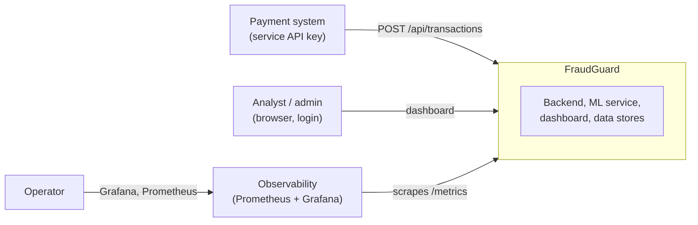
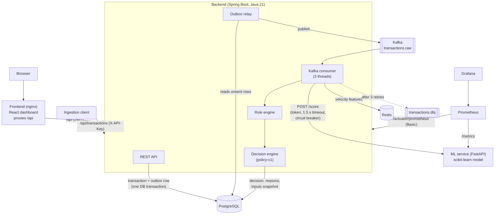
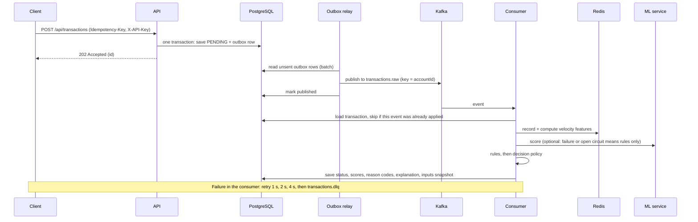
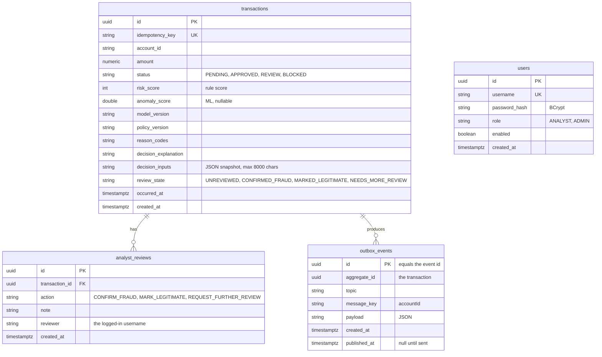

# Architecture

> **Honesty note.** FraudGuard is a demo built on **synthetic data**. It shows an architecture and engineering
> decisions. It says nothing about how well it would detect real fraud, and it is not production-grade
> (single Kafka broker, one database, shared secrets, no notifications).

## What it does

A client sends a payment to the API. The API stores it and answers immediately (`202 Accepted`). In the background the
transaction is enriched with recent-behaviour features from Redis, scored by fraud **rules** and by an **ML anomaly
model**, and a **decision policy** turns both into `APPROVED`, `REVIEW` or `BLOCKED` with plain-English reasons. Analysts
review the risky ones in a dashboard, and their verdicts feed retraining of the ML model.

## Context

## Containers

| Component | Responsibility |
|---|---|
| **Backend** | API, persistence, outbox, Kafka consumer, Redis features, rules, decision policy, auth, admin tools |
| **ML service** | Scoring only (`POST /score`), model registry and hot reload, Prometheus metrics. Optional: the backend works without it |
| **Frontend** | Analyst dashboard (login, list, filters, detail, review, model feedback card) |
| **PostgreSQL** | System of record: transactions, outbox, analyst reviews, users |
| **Redis** | Recent-behaviour features per account (counts, averages, last device and country) |
| **Kafka** | Decouples intake from processing. One broker locally |
| **Prometheus + Grafana** | Metrics, a dashboard as code, 12 alert rules |

## One transaction's life

Why it is built this way: the outbox row and the transaction are saved together, so an event is never lost and never
sent for a transaction that was not saved ([ADR 0002](adr/0002-transactional-outbox.md)). Kafka may deliver an event twice,
so the consumer ignores an event id it has already applied.

## Data model

The model's decision (`status`) is never changed by an analyst. The analyst's verdict is stored separately: `analyst_reviews`
is append-only history and `transactions.review_state` is the current verdict.

## Kafka topics

| Topic | Partitions | Used by | Notes |
|---|---|---|---|
| `transactions.raw` | 3 | Outbox relay writes, consumer reads | Key = `accountId`, so one account's events stay ordered |
| `transactions.dlq` | 3 | Error handler writes, `GET /api/admin/dlq/summary` reads | Events that failed after retries, or were malformed |
| `transactions.scored`, `transactions.decisions` | 3 | **Nothing** | Created at start-up but unused: one consumer does features, rules, ML and the decision in one step. They are left over from the original design and could be removed |

## Failure modes

Each row was tried for real; see the results in [observability.md](observability.md#failure-drills).

| What fails | What happens | How you notice | Drill |
|---|---|---|---|
| ML service down or frozen | Decisions continue with rules only (`ML_UNAVAILABLE`); circuit opens after 3 failures for 30 s | `MlCircuitOpen`, ML panels | [1](../scripts/drills/01-ml-service-down.sh), [2](../scripts/drills/02-ml-service-hangs.sh) |
| Redis down | API still accepts (it does not use Redis). The consumer retries, then dead-letters; transactions stay PENDING until re-driven | `TransactionsStuckPending`, `DlqEventsDetected`, readiness 503 | [3](../scripts/drills/03-redis-down.sh) |
| Kafka down | API still returns 202; the outbox grows and drains in order when Kafka returns | `OutboxBacklog` | [4](../scripts/drills/04-kafka-down.sh) |
| PostgreSQL down | API errors (500), readiness 503; recovers by itself | `Http5xxRate`, `HikariSaturation`, `BackendDown` | [5](../scripts/drills/05-postgres-down.sh) |
| Malformed message | Straight to the DLQ, no retries | `DlqEventsDetected` | [6](../scripts/drills/06-poison-message.sh) |
| Duplicate delivery | Recognised and skipped | `outcome="duplicate"` counter | [7](../scripts/drills/07-duplicate-event.sh) |
| Backend restart under load | Nothing lost; Kafka offsets and the outbox are durable | PENDING returns to 0 | [8](../scripts/drills/08-backend-restart-under-load.sh) |
| Corrupt model registry | Reload refused (409), old model keeps serving | `ml_model_reloads_total{outcome="failure"}` | [9](../scripts/drills/09-corrupt-registry.sh) |

## Security

Three filter chains: `/actuator/**` (HTTP Basic, METRICS role; health is public), `/api/**` (stateless JWT; ingestion uses a
service API key), everything else closed (apart from the API description and Swagger UI). Roles: `ANALYST` (review) and
`ADMIN` (also training-data export and operator tools, shown in the dashboard's Operations tab). The ML service's `/score` and `/admin/*` need shared tokens. See
[ADR 0008](adr/0008-stateless-jwt.md) and the limitations in [observability.md](observability.md#limitations).

## ML model artifacts

Trained model files are **not stored in git**. `python ml-service/training/train.py` (or the Docker build) trains the baseline
`isoforest-v1` from synthetic data with a fixed seed, so a fresh clone and the Docker image get the same model. Retrained
models (`gbm-*`), the registry (`registry.json`) and exported labels are local runtime state and are git-ignored. Without a
registry the service serves `isoforest-v1`. Details of retraining and promotion: [feedback-loop.md](feedback-loop.md).

## Where to go next

[decision-policy.md](decision-policy.md) (how the final decision is made), [feedback-loop.md](feedback-loop.md) (labels,
retraining, promotion), [observability.md](observability.md) (metrics, alerts, runbooks, drills), [testing.md](testing.md),
[performance.md](performance.md), [api-examples.http](api-examples.http) and the generated [openapi.json](openapi.json).
